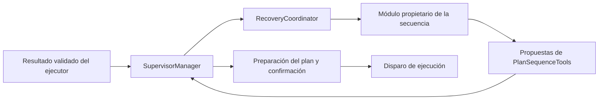

# Recuperaciones y secuencias especiales del supervisor

Esta guía describe la implementación de `supervisor_manager`, cómo configurarla y
cómo agregar casos. No requiere modificar los paquetes de navegación, ejecutor,
HRI o percepción. El README del paquete se conserva.

## Responsabilidades y flujo

`supervisor_manager_node.cpp` conserva el arranque, la comprobación inicial del
sistema, las suscripciones, la preparación del plan y su despacho. Las decisiones
sobre errores y secuencias se ejecutan en módulos independientes.



Los módulos no publican permisos de plan por su cuenta. Proponen insertar una
instrucción, repetir, rebobinar o saltar pasos mediante `RecoveryContext`. El
manager acumula esas operaciones y las envía a
`/supervisor/supervisor_plan/prepare_cycle`. Solo después de recibir `ready`
libera un ciclo de ejecución. Si faltan dependencias, conserva el despacho.

Al terminar una secuencia se retoma el cursor del plan original. Si ya no quedan
pasos, el manager finaliza o solicita otra tarea en modo de lenguaje natural.
Las secuencias correctivas pueden ejecutarse aunque el paso original fuera el
último: una inserción o reintento pendiente tiene prioridad sobre finalizar.

## Módulos y archivos

Las interfaces están en `include/supervisor_manager/` y las implementaciones en
`src/recovery/`.

| Componente | Responsabilidad | Archivo de implementación |
| --- | --- | --- |
| `NavigationRecoveryModule` | Navegación, llegada, nueva ubicación y reintentos de acercamiento/alineación general | `navigation_recovery_module.cpp` |
| `ManipulationRecoveryModule` | Agarre, acercamiento correctivo, entrega fuera de alcance y verificación | `manipulation_recovery_module.cpp` |
| `PerceptionRecovery` | Reintentos de búsqueda de objetos/espacio, análisis y enfoque | `perception_recovery.cpp` |
| `PersonRecovery` | Búsqueda y análisis de personas, refresco de pose y acercamiento preventivo/correctivo | `person_recovery.cpp` |
| `InteractionRecovery` | Escucha, espera de “continue”, captura y confirmación de datos | `interaction_recovery.cpp` |
| `DoorSequence` | Comprobación de puerta, ayuda, espera y reintento | `door_sequence.cpp` |
| `FollowSequence` | Autorización, seguimiento, parada, llegada y entrega opcional | `follow_sequence.cpp` |
| `TaskAcquisition` | Adquisición y validación de órdenes GPSR y conversión a metas CLIPS | `task_acquisition.cpp` |
| `RecoveryCoordinator` | Propiedad de secuencias, selección de módulo y vigilancia de resultados | `recovery_coordinator.cpp` |
| `RecoverySupport` | Normalización, servicios auxiliares y propuestas comunes | `recovery_support.cpp` |

`NavigationRecovery` y `ManipulationRecovery`, en los archivos existentes de
`src/`, conservan las políticas puras probadas por los primeros pilotos. Sus
módulos ahora contienen la ejecución y los estados que antes estaban en el
manager. `PnpRecoveryManager`, en `pnp_recovery.cpp`, conserva la política PNP;
su adaptación a resultados/instrucciones está en el módulo de manipulación.

`PlanSequenceTools`, en `plan_sequence_tools.hpp`, construye el lote de
modificaciones. `RetryRules`, en `retry_rules.hpp`, interpreta casos YAML de
reintento acotado. `RecoveryContext` transporta los servicios y callbacks del
manager, no un segundo nodo ROS.

## Propiedad y selección

Una secuencia activa recibe los resultados antes que los casos genéricos. Así,
el fallo de un `approach` insertado para agarrar un objeto pertenece a
manipulación; un `approach customer_N` pertenece a personas. Una instrucción
correctiva no debe iniciar otra recuperación independiente mientras su módulo
propietario sigue activo.

Sin propietario activo, se evalúan puerta, seguimiento, personas, navegación,
manipulación/PNP, percepción e interacción. Un módulo devuelve `true` cuando ya
manejó el evento; `false` deja continuar la evaluación o el flujo nominal. Si
ninguno maneja un fallo, se aplica el anuncio y la decisión genérica de terminar
o continuar.

Los resultados ajenos a una secuencia activa no autorizan avanzar esa secuencia.
La interfaz actual no contiene un identificador de ejecución: todavía no permite
distinguir perfectamente dos resultados atrasados con acción y argumento
idénticos. Agregar ese identificador requiere coordinar cambios en las interfaces
y el ejecutor; no se hizo en esta extracción.

## Configuración

Se usan tres archivos instalados en `share/supervisor_manager/config/`:

| Archivo | Parámetro ROS | Contenido |
| --- | --- | --- |
| `navigation_recovery.yaml` | `navigation_recovery_config` | Ubicación desconocida, fallo de navegación, llegada y bumper |
| `manipulation_recovery.yaml` | `manipulation_recovery_config` | Secuencia `approach -> take` por alcance |
| `recovery_modules.yaml` | `recovery_modules_config` | Los demás casos, secuencias y límites comunes |

Las frases, intentos y tiempos se leen al arrancar. Usa una copia del archivo y
reinicia el manager para recargarla:

```bash
ros2 run supervisor_manager supervisor_manager_node --ros-args \
  -p recovery_modules_config:=/ruta/recovery_modules.yaml \
  -p continue_on_recovery_failure:=true
```

Configurar archivos externos evita depender de la copia instalada. Conserva las
secciones requeridas del archivo completo; no pases únicamente un fragmento.
Los constructores validan los tipos y límites utilizados por cada módulo. Una
configuración que no pueda cargarse impide el arranque.

`continue_on_recovery_failure` se consulta al tomar la decisión final. Puede
cambiarse durante la ejecución:

```bash
ros2 param set /supervisor_manager_node continue_on_recovery_failure true
```

- `true`: al agotarse una recuperación, anuncia el fallo y omite el paso para
  seguir depurando el plan, si quedan instrucciones.
- `false`: al agotarse la recuperación, detiene el plan.

El parámetro no elimina reintentos ni permite avanzar antes de concluir una
secuencia. Bumper, efectos físicos inciertos, fallo del protocolo y parada de
seguimiento no confirmada detienen el plan. La política PNP mantiene sus reglas
propias de posponer objetos, verificar transporte y segunda pasada.

## Puerta: tres comprobaciones en total

`DoorSequence` reconoce comprobaciones de puerta (`check` o `wait_for`) y cuenta
cada resultado fallido, incluido fallo de servicio o timeout.

```text
CHECK_RESULT -> OPEN -> continuar plan
             -> CLOSED/SERVICE_FAILED/TIMEOUT -> WAIT_RETRY -> repetir check
             -> tercer fallo -> continuar para debug o detener
```

La configuración predeterminada:

```yaml
door:
  max_attempts: 3
  retry_delay_sec: 5.0
  execution_timeout_sec: 15.0
  closed_phrase: "Please open the door so I can continue."
  service_failed_phrase: "I could not check the door. I will try again."
  opened_phrase: "I detected that the door is open. Thank you."
  exhausted_phrase: "I could not confirm that the door is open."
```

La consulta nominal cuenta como primer intento: tres fallos producen dos
reintentos adicionales. Una puerta abierta termina la secuencia inmediatamente.
Un fallo técnico no se interpreta como una lectura de puerta cerrada. Al agotar
los intentos se aplica `continue_on_recovery_failure`, también para puerta.

Los argumentos efectivamente soportados dependen del ejecutor existente; su
herramienta `Check` reconoce `door`, `door_open` y `open_door`.

## Seguimiento

Los disparadores son resultados exitosos de:

- `say instruct_follow_only`: seguir y detenerse.
- `say instruct_follow_person`: seguir, detenerse y ejecutar `drop floor`.
- `say instruct_follow_to_<destino>`: seguir hasta verificar el destino con TF
  y detenerse.

La secuencia inserta `listen follow`, `follow enable` y `follow disable` según
los resultados. Escuchar “stop” antes de empezar evita activar seguimiento;
en la variante de entrega conserva la entrega prevista.

La autorización requiere “follow” o “continue”. Al agotar `start_attempts` no se
activa seguimiento por silencio. Si se agotan `stop_attempts` o el tiempo para
llegar al destino, se solicita `follow disable` antes de continuar/terminar.
La comprobación de destino se realiza por ticks; no bloquea el manager con un
bucle de varios minutos.

`disable_attempts` limita la desactivación. Si no puede confirmarse que el
seguimiento se desactivó, el plan se detiene incluso en modo debug. `drop floor`
solo se inserta cuando corresponde a la variante y no se está abandonando una
secuencia fallida.

## Navegación y ubicaciones

Una ubicación capturada se normaliza y valida mediante
`navigation_locations_service`, por defecto `/locations_manager/get`. Solo una
respuesta exitosa autoriza insertar `go_to` con el nuevo nombre. No se utiliza el
catálogo semántico de `knowledge_bank` para validar la recuperación.

La respuesta de voz pasa por `/planning/semantic_parser/extract_entity` con
categoría `LOCATION` antes de validar. Admite un nombre directo (`Kitchen bar.`)
o frases como `Please go to the kitchen bar` y `Could you go to the cooking table?`.
El extractor retira envolturas lingüísticas comunes y devuelve el nombre propuesto;
no consulta otro catálogo ni garantiza que exista. La autoridad sigue siendo
`/locations_manager/get`. Respuestas con varios destinos se rechazan. Si el
extractor no está disponible o vence `service_timeout_sec`, se consume un intento
y se repregunta respetando el presupuesto de recuperación; no se omite la extracción.
Iniciar `entity_extractor_node` bajo el namespace `/planning/semantic_parser`.

Las confirmaciones verbales ya utilizan `Planning::extractEntity(..., "confirm")`.
`CONFIRM` devuelve `yes` o `no`, y deja vacío ante silencio o contradicción.
`not correct` se interpreta como rechazo. Con `ask_data_confirmation_enabled=true`
solo una aprobación explícita acepta el dato; rechazo o respuesta ambigua repiten
la captura hasta `interaction.confirmation_attempts`. Al agotarse, se aplica
`continue_on_recovery_failure`. Con la confirmación desactivada se conserva la
aceptación sin pregunta adicional.

Voz, escucha, extracción, validación y sus estados viven en `NavigationRecoveryModule`.
La política `NavigationRecovery` lee `ask_location`, `retry` y `abort` del YAML.
Esos comportamientos están implementados en C++; el YAML los selecciona, no
crea operaciones nuevas. El destino corregido afecta al paso fallido y sus
reintentos, sin cambiar destinos en pasos futuros.

La comprobación adicional de llegada utiliza TF y tolerancia de distancia. Si
no existe la TF necesaria, se conserva el comportamiento anterior de aceptar
el éxito validado del ejecutor con una advertencia; no se inventa una posición.

## Manipulación y personas

`take_pose_out_of_range` conserva `approach objeto -> take objeto` con el
presupuesto definido en `manipulation_recovery.yaml`. Si el acercamiento falla,
no se ejecuta el segundo agarre. Otra falla del agarre termina esa secuencia;
una nueva falla de alcance puede iniciar otro ciclo si queda presupuesto.

`drop` fuera de alcance inserta `approach safe_drop_1` y después el `drop`
original. La recuperación es única por episodio, sin cambiar el objeto.
`verify_take` de objetos no administrados por PNP admite un reintento configurable.
PNP conserva la verificación después de un agarre exitoso y sus recorridos
específicos. Las fallas generales de `take` conservan su reintento simple y las
recuperaciones PNP tienen su propio límite configurado.

`PersonRecovery` conserva el acercamiento parcial, la actualización de pose y
el acercamiento refinado de `customer_N`. `max_sequence_failures` limita las
fallas de la secuencia. Las búsquedas y el análisis de personas usan casos de
reintento YAML; ya no se espera indefinidamente un gesto que no aparece.

Los reportes actuales no incluyen la fase física completa del brazo. No todos
los errores de entrega/recepción/doblado deben repetirse: el manejo predeterminado
para acciones sin caso específico es terminar o continuar según el modo debug.
Un reporte `physical_effect_uncertain` siempre termina la tarea.

## Resultados que no llegan

El coordinador vigila cada instrucción observada en `/instruction_msg`:

- Puerta: `door.execution_timeout_sec`.
- Pasos del seguimiento activo: `follow.execution_timeout_sec`.
- Resto: `coordinator.execution_timeout_sec`.

Al agotarse el tiempo, solicita cancelar las acciones al servicio estándar
`/executor/execute_task/_action/cancel_goal`. Si hay objetivos cancelándose,
espera sus resultados terminales en el servicio estándar `get_result` antes
de proponer otro despacho. Si llega un reporte real durante la cancelación,
lo prefiere a un timeout sintético.

Sin objetivos activos y sin reporte, genera un evento `TIMEOUT` para el módulo
propietario. Así una comprobación de puerta sin respuesta consume un intento.
Un resultado terminal de éxito/fallo sin reporte validado no autoriza repetir
una acción con efectos desconocidos: se omite o detiene según el modo debug.
Las comprobaciones de puerta siguen contando el intento sin confirmación y el
seguimiento solicita desactivación antes de abandonar la secuencia. Un timeout de manipulación
sin reporte se clasifica como efecto físico incierto y detiene la tarea.
`cancel_timeout_sec` limita la confirmación. Si cancelar o confirmar la
terminación no es posible, se detiene sin despachar otra acción. También se
detiene si existe un resultado pero falta el estado de plan necesario para
interpretarlo al vencer el plazo. Estas son fallas de coordinación, no esperas
indefinidas.

Algunos auxiliares de voz, confirmación, cabeza y adquisición GPSR conservan
llamadas síncronas acotadas a servicios. No todos los módulos son completamente
asíncronos: pueden demorar un tick durante esas llamadas. El manager ya no
contiene sus estados o comportamiento, y el seguimiento de destino sí es
asíncrono. Convertir todos esos auxiliares a operaciones no bloqueantes es una
mejora posterior, distinta de esta separación.

## Agregar un caso YAML de reintento

`RetryRules` sirve cuando la recuperación consiste en repetir la instrucción
actual con un límite. Por ejemplo, dentro de `perception.cases`, antes del caso
genérico de `find_space`:

```yaml
container_scan_zone:
  enabled: true
  actions: [find_space]
  worker_prefix: "container_out_of_scan_zone"
  max_retries: 1
  phrase: "I could not see the container clearly. I will scan again."
```

Campos admitidos:

| Campo | Significado |
| --- | --- |
| Nombre de la entrada | Identificador mostrado en logs |
| `enabled` | Activación, `true` por defecto |
| `actions` | Acciones a las que aplica, en minúsculas |
| `reasons` | Códigos de `failure_reason` admitidos, opcional |
| `worker_prefix` | Prefijo admitido de `worker_result`, opcional |
| `worker_suffix` | Sufijo admitido de `worker_result`, opcional |
| `max_retries` | Reintentos adicionales; la ejecución nominal no cuenta |
| `phrase` | Frase opcional, con sustitución de `{argument}` |

Las condiciones de resultado (`reasons`, prefijo y sufijo) son alternativas:
si se especifican, basta con cumplir una, además de la acción. Sin ellas el
caso captura cualquier resultado fallido de esa acción. El motor no convierte
un resultado exitoso en fallo y reinicia su presupuesto al éxito, agotamiento
o inicio de otro plan.

Se elige el primer caso que coincide: coloca los casos específicos antes de los
genéricos. Usa el módulo responsable del dominio y revisa si ya hay una secuencia
que capture ese evento antes del reintento genérico. Un caso de puerta no debe
agregarse a interacción si `DoorSequence` debe mantener la condición.

Para conocer el evento real, consulta los logs del reporte:

```text
action='find_space' argument='container'
status=FAILURE approved=false
failure_reason='find_space_failed'
worker_result='container_out_of_scan_zone'
```

Configurar una frase y un límite no implementa un nuevo movimiento ni permite
invocar acciones que el ejecutor no conoce.

## Agregar una secuencia C++

Una recuperación que cambia pasos necesita estados en el módulo, no solo una
entrada YAML. Ejemplo conceptual:

```text
IDLE + error elegible -> insertar find_object -> WAIT_FIND
WAIT_FIND + éxito    -> insertar take        -> WAIT_TAKE
WAIT_FIND + fallo    -> repetir o agotar presupuesto
WAIT_TAKE + éxito    -> liberar propietario y procesar éxito normal
WAIT_TAKE + fallo    -> continuar para debug o detener
```

Implementa `handleFeedback(const Report&)`, `active()`, `reset()` y, si tiene
esperas, `tick()` en el componente correspondiente. Valida acción y argumento
del paso esperado. Cada estado debe tener una salida por éxito, fallo, timeout
o agotamiento. Evita bucles sin límite.

Las operaciones disponibles mediante `RecoverySupport` son:

```cpp
// Una instrucción temporal: no consume el siguiente paso original.
dispatchOverrideInstruction("Justina find_object " + object);

// Repetir lo último efectivamente despachado.
publishRetryCommand();
publishAllowNextCycle();

// Captura: rebobinar el listen nominal e insertar una pregunta antes.
context_.rewind();
dispatchOverrideInstruction("Justina say ask_name");

// Finalizar un episodio fallido con la política común.
finishFailedStep(continueAfterRecoveryFailure());
```

No insertes dos instrucciones temporales en un mismo lote: el plan existente
admite una sola instrucción override. La segunda se inserta después de recibir
el resultado de la primera. `PlanSequenceTools` rechaza overrides múltiples y
la combinación retry/override en un mismo despacho para evitar pérdida de pasos.

La herramienta maneja operaciones sobre el cursor actual, no ofrece lectura
arbitraria de instrucciones futuras. Patrones como `say ask_* -> listen dato`
se reconocen con estado e historial de resultados. Inspeccionar y editar planes
futuros completos necesitaría una API adicional del planificador.

Si creas otro módulo, agréguelo al coordinador, defina una prioridad y una única
propiedad activa, y añada sus fuentes a `supervisor_recovery_modules` en CMake.
No agregues lógica de dominio al manager ni publicaciones directas de permisos.

## Logs y verificación

- `[RecoveryCoordinator]`: propietario, timeout y cancelación.
- Etiqueta del módulo: caso, estado, intentos y resultado.
- `[PlanMutation]`: instrucciones insertadas, reintentos y saltos.
- `[PlanDispatch]`: lote preparado y confirmación antes de ejecutar.
- `CURRENT_INSTRUCTION`: instrucción efectivamente despachada.
- `[RecoveryOutcome]`: decisión final `CONTINUE` o `STOP`.

Compilar y ejecutar pruebas unitarias:

```bash
colcon build --packages-select supervisor_manager
source install/setup.bash
colcon test --packages-select supervisor_manager --ctest-args \
  -R 'test_(recovery_modules|manipulation_recovery|navigation_recovery|pnp_recovery)'
```

Pruebas integradas sin hardware:

```bash
ROS_AUTOMATIC_DISCOVERY_RANGE=LOCALHOST /usr/bin/python3 \
  src/Supervisor/supervisor_manager/test/recovery_modules_smoke.py door_closed \
  --continue-on-failure
ROS_AUTOMATIC_DISCOVERY_RANGE=LOCALHOST /usr/bin/python3 \
  src/Supervisor/supervisor_manager/test/recovery_modules_smoke.py door_timeout
ROS_AUTOMATIC_DISCOVERY_RANGE=LOCALHOST /usr/bin/python3 \
  src/Supervisor/supervisor_manager/test/recovery_modules_smoke.py follow_no_stop \
  --continue-on-failure
```

El script admite también escenarios de percepción, personas, recaptura, drop,
verificación y cancelación; consulta `--help`. Ejecuta manager y plan reales,
con ejecutor/HRI simulados, sin drivers. Usa un dominio ROS aislado, configurable
con `ROS_DOMAIN_ID`, y necesita sockets DDS locales. Los fixtures responden a
interfaces existentes; no modifican los paquetes ajenos.

Para cada nuevo caso, comprueba éxito, agotamiento, ambos valores del modo debug,
argumentos ajenos a una recuperación y retorno al siguiente paso original. Para
una secuencia con movimiento persistente, comprueba la parada antes de avanzar.
